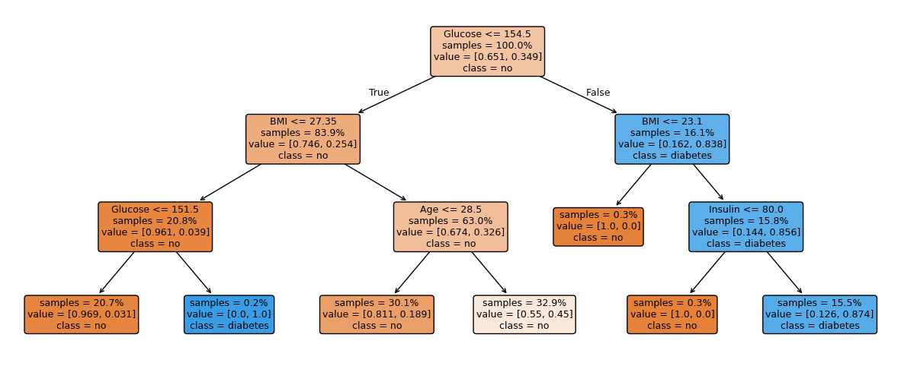
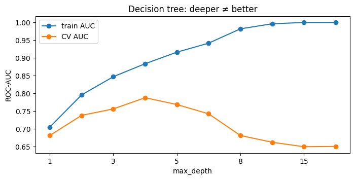
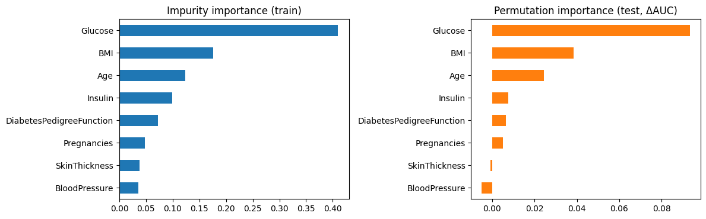
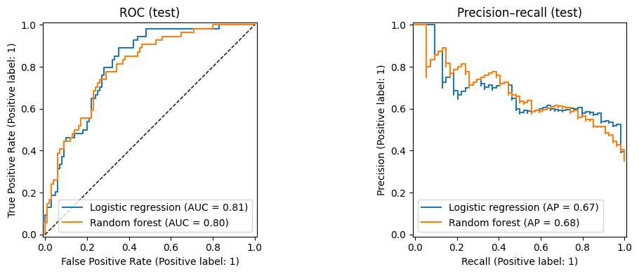

::: {.callout-note appearance="simple"}
## ใช้หน้านี้อย่างไร
หน้านี้คือ notebook `labs/lab2-random-forest.ipynb` ทั้งหมด พร้อมผลลัพธ์และกราฟ อ่านทวนก่อนหรือหลังคลาสได้
ช่อง TODO แสดงโค้ดตั้งต้นแบบที่เห็นในคลาส คำตอบอยู่ในกล่อง **ดูเฉลย** — ลองคิดเองก่อนเปิด
ลงมือรันจริงใน repo ที่ fork ไว้ ([เตรียมเครื่อง](../setup/github.qmd)) · ตารางเวลาและภาพรวมอยู่ที่ [แผน lab](../labs.qmd)
:::

<!-- generated by tools/build_lab_pages.py from labs/src/lab2-random-forest.py — edit the source, not this page -->

Lab 1 ได้ logistic regression ROC-AUC ≈ 0.81 — model เส้นตรงจับความสัมพันธ์แบบ "ยิ่งมากยิ่งเสี่ยง" ได้ดี
แต่ถ้าความเสี่ยงขึ้นแบบ **ไม่เป็นเส้นตรง** หรือ feature **ส่งผลร่วมกัน** (เช่น น้ำตาลสูง *และ* BMI สูง) ล่ะ?

Lab นี้:
1. รู้จัก **decision tree** และปัญหา overfitting
2. รวมต้นไม้หลายร้อยต้นเป็น **Random Forest**
3. เทียบ model ด้วย **cross-validation** (ไม่แตะ test) และ tune ด้วย `GridSearchCV`
4. เลือก model + threshold สุดท้าย แล้วประเมินบน test **ครั้งเดียว**
5. บันทึก model เป็นไฟล์ (`joblib`) เพื่อเอาไปทำ app

⚠️ *เพื่อการเรียนรู้เท่านั้น — ไม่ใช่เครื่องมือทางการแพทย์*

*Data: Smith et al. (1988). Pima Indians Diabetes Database (NIDDK), via the UCI Machine Learning Repository.*

```python
import numpy as np
import pandas as pd
import matplotlib.pyplot as plt
from sklearn.model_selection import train_test_split, StratifiedKFold

from mlia import load_checkpoint, save_checkpoint, show_check, RANDOM_STATE

pd.set_option("display.precision", 3)
plt.rcParams["figure.figsize"] = (8, 4)

# เตรียมข้อมูลเหมือน Lab 1 ทุกประการ (0 → NaN, split 80/20 แบบ stratify, random_state เดิม)
FEATURES = ["Pregnancies", "Glucose", "BloodPressure", "SkinThickness", "Insulin", "BMI",
            "DiabetesPedigreeFunction", "Age"]
ZERO_AS_MISSING = ["Glucose", "BloodPressure", "SkinThickness", "Insulin", "BMI"]
df = pd.read_csv("data/diabetes.csv")
df[ZERO_AS_MISSING] = df[ZERO_AS_MISSING].replace(0, np.nan)
X, y = df[FEATURES], df["Outcome"]
X_train, X_test, y_train, y_test = train_test_split(X, y, test_size=0.2, stratify=y, random_state=RANDOM_STATE)
cv = StratifiedKFold(n_splits=5, shuffle=True, random_state=RANDOM_STATE)
print(X_train.shape, X_test.shape)
```

```{.text .cell-output}
(614, 8) (154, 8)
```

## 2.1 Decision tree: ถามคำถามใช่/ไม่ใช่ทีละข้อ {#s2-1}

::: {.theory-link}
ทฤษฎีของหัวข้อนี้: [M2 · Decision tree → Random Forest](../m2-models/index.qmd)
:::

**decision tree** แบ่งข้อมูลด้วยคำถามอย่าง "`Glucose ≤ 127.5` ไหม?" เลือกคำถามที่ทำให้แต่ละฝั่ง "บริสุทธิ์" ที่สุด
(คลาสเดียวกันมากที่สุด วัดด้วย Gini impurity) แล้วถามต่อในแต่ละฝั่ง — อ่านง่ายเหมือน flowchart ของแพทย์

tree ไม่ต้อง scale ข้อมูล (ถามแค่มากกว่า/น้อยกว่า) แต่ใน scikit-learn ยังต้องเติม NaN ก่อน

```python
from sklearn.pipeline import make_pipeline
from sklearn.impute import SimpleImputer
from sklearn.tree import DecisionTreeClassifier, plot_tree

tree3 = make_pipeline(SimpleImputer(strategy="median"),
                      DecisionTreeClassifier(max_depth=3, random_state=RANDOM_STATE)).fit(X_train, y_train)

fig, ax = plt.subplots(figsize=(15, 6))
plot_tree(tree3[-1], feature_names=FEATURES, class_names=["no", "diabetes"], filled=True, rounded=True,
          impurity=False, proportion=True, fontsize=9, ax=ax)
plt.show()
```

{.cell-figure}

**อ่านต้นไม้:** คำถามแรกคือ `Glucose` (ตรงกับ Lab 1 ว่าสำคัญที่สุด) ตามด้วย `BMI` และ `Age`
แต่ละกล่องบอกสัดส่วนข้อมูล (`samples`) และสัดส่วนของแต่ละคลาส (`value`)

### ต้นไม้ลึกเกินไป = ท่องจำข้อสอบ (overfitting)

ลองเพิ่มความลึก แล้วดู ROC-AUC บน **train** เทียบกับ **cross-validation**

```python
from sklearn.model_selection import cross_validate

rows = []
for depth in [1, 2, 3, 4, 5, 6, 8, 10, 15, None]:
    model = make_pipeline(SimpleImputer(strategy="median"),
                          DecisionTreeClassifier(max_depth=depth, random_state=RANDOM_STATE))
    r = cross_validate(model, X_train, y_train, cv=cv, scoring="roc_auc", return_train_score=True)
    rows.append({"max_depth": str(depth), "train AUC": r["train_score"].mean(), "CV AUC": r["test_score"].mean()})
depth_df = pd.DataFrame(rows)

ax = depth_df.plot(x="max_depth", y=["train AUC", "CV AUC"], marker="o", figsize=(8, 3.5))
ax.set(title="Decision tree: deeper ≠ better", ylabel="ROC-AUC"); plt.show()
depth_df
```

{.cell-figure}

::: {.cell-output-table}
```{=html}
<div>

<table border="1" class="dataframe">
  <thead>
    <tr style="text-align: right;">
      <th></th>
      <th>max_depth</th>
      <th>train AUC</th>
      <th>CV AUC</th>
    </tr>
  </thead>
  <tbody>
    <tr>
      <th>0</th>
      <td>1</td>
      <td>0.706</td>
      <td>0.682</td>
    </tr>
    <tr>
      <th>1</th>
      <td>2</td>
      <td>0.796</td>
      <td>0.738</td>
    </tr>
    <tr>
      <th>2</th>
      <td>3</td>
      <td>0.847</td>
      <td>0.757</td>
    </tr>
    <tr>
      <th>3</th>
      <td>4</td>
      <td>0.884</td>
      <td>0.788</td>
    </tr>
    <tr>
      <th>4</th>
      <td>5</td>
      <td>0.916</td>
      <td>0.769</td>
    </tr>
    <tr>
      <th>5</th>
      <td>6</td>
      <td>0.942</td>
      <td>0.743</td>
    </tr>
    <tr>
      <th>6</th>
      <td>8</td>
      <td>0.982</td>
      <td>0.682</td>
    </tr>
    <tr>
      <th>7</th>
      <td>10</td>
      <td>0.996</td>
      <td>0.663</td>
    </tr>
    <tr>
      <th>8</th>
      <td>15</td>
      <td>1.000</td>
      <td>0.650</td>
    </tr>
    <tr>
      <th>9</th>
      <td>None</td>
      <td>1.000</td>
      <td>0.651</td>
    </tr>
  </tbody>
</table>
</div>
```
:::

ต้นไม้ไม่จำกัดความลึกได้ train AUC = 1.0 (จำทุกแถวได้) แต่ CV AUC ตกลง — **นี่คือ overfitting**
ต้นไม้ต้นเดียวจึง "ไม่นิ่ง" (high variance): เปลี่ยนข้อมูลนิดเดียว ต้นไม้เปลี่ยนทั้งต้น

## 2.2 Random Forest: ภูมิปัญญาของฝูงชน {#s2-2}

::: {.theory-link}
ทฤษฎีของหัวข้อนี้: [M2 · Decision tree → Random Forest](../m2-models/index.qmd)
:::

**Random Forest** สร้างต้นไม้หลายร้อยต้น แต่ละต้น:
- เรียนจากข้อมูลที่ **สุ่มแบบใส่คืน (bootstrap)** คนละชุด
- ทุกครั้งที่แตกกิ่ง สุ่มดู feature แค่บางตัว (`max_features`) → ต้นไม้ไม่เหมือนกัน

แล้ว **เฉลี่ยความน่าจะเป็น** จากทุกต้น ความผิดพลาดของแต่ละต้นหักล้างกัน → ได้ model ที่นิ่งและแม่นขึ้น

Hyperparameter สำคัญ: `n_estimators` (จำนวนต้น), `max_depth`, `min_samples_leaf` (ใบต้องมีอย่างน้อยกี่แถว — ยิ่งมากยิ่งกัน overfit), `max_features`

```python
from sklearn.ensemble import RandomForestClassifier

# TODO 2.2: สร้าง pipeline: SimpleImputer(strategy="median") → RandomForestClassifier(n_estimators=300, min_samples_leaf=5, random_state=RANDOM_STATE, n_jobs=-1) แล้ว fit กับ train
rf = make_pipeline(___, ___)
rf.fit(___, ___)
rf
```

::: {.callout-tip collapse="true" appearance="simple"}
## ดูเฉลย

```python
from sklearn.ensemble import RandomForestClassifier

# ✔ TODO 2.2: สร้าง pipeline: SimpleImputer(strategy="median") → RandomForestClassifier(n_estimators=300, min_samples_leaf=5, random_state=RANDOM_STATE, n_jobs=-1) แล้ว fit กับ train
rf = make_pipeline(SimpleImputer(strategy="median"),
                   RandomForestClassifier(n_estimators=300, min_samples_leaf=5, random_state=RANDOM_STATE, n_jobs=-1))
rf.fit(X_train, y_train)
rf
```
:::

```{.text .cell-output}
Pipeline(steps=[('simpleimputer', SimpleImputer(strategy='median')),
                ('randomforestclassifier',
                 RandomForestClassifier(min_samples_leaf=5, n_estimators=300,
                                        n_jobs=-1, random_state=42))])
```

```python
show_check(hasattr(rf, "classes_") and len(rf[-1].estimators_) == 300, "fit Random Forest 300 ต้นแล้ว",
           "ยังไม่ได้ fit — ตรวจ n_estimators=300 และ .fit(X_train, y_train)")
```

```{.text .cell-output}
✅ fit Random Forest 300 ต้นแล้ว
```

## 2.3 เทียบ model อย่างเป็นธรรมด้วย cross-validation {#s2-3}

::: {.theory-link}
ทฤษฎีของหัวข้อนี้: [M2 · Decision tree → Random Forest](../m2-models/index.qmd)
:::

**5-fold cross-validation**: แบ่ง train เป็น 5 ส่วน สลับใช้ 4 ส่วนสอน 1 ส่วนวัด ครบ 5 รอบ แล้วเฉลี่ย
ได้ทั้ง **ค่าเฉลี่ย** และ **ความแกว่ง** (SD) — test set ยังไม่ถูกแตะเลย

```python
from sklearn.preprocessing import StandardScaler
from sklearn.linear_model import LogisticRegression

logreg = make_pipeline(SimpleImputer(strategy="median"), StandardScaler(), LogisticRegression(max_iter=1000))
SCORING = ["roc_auc", "average_precision", "recall", "precision"]

# TODO 2.3: ใช้ cross_validate(model, X_train, y_train, cv=cv, scoring=SCORING) กับทั้งสอง model เก็บผลใน dict results
results = {name: ___ for name, m in [("Logistic regression", logreg), ("Random forest", rf)]}

summary = pd.DataFrame({name: {f"{s} (mean ± sd)": f"{r[f'test_{s}'].mean():.3f} ± {r[f'test_{s}'].std():.3f}" for s in SCORING}
                        for name, r in results.items()})
summary
```

::: {.callout-tip collapse="true" appearance="simple"}
## ดูเฉลย

```python
from sklearn.preprocessing import StandardScaler
from sklearn.linear_model import LogisticRegression

logreg = make_pipeline(SimpleImputer(strategy="median"), StandardScaler(), LogisticRegression(max_iter=1000))
SCORING = ["roc_auc", "average_precision", "recall", "precision"]

# ✔ TODO 2.3: ใช้ cross_validate(model, X_train, y_train, cv=cv, scoring=SCORING) กับทั้งสอง model เก็บผลใน dict results
results = {name: cross_validate(m, X_train, y_train, cv=cv, scoring=SCORING)
           for name, m in [("Logistic regression", logreg), ("Random forest", rf)]}

summary = pd.DataFrame({name: {f"{s} (mean ± sd)": f"{r[f'test_{s}'].mean():.3f} ± {r[f'test_{s}'].std():.3f}" for s in SCORING}
                        for name, r in results.items()})
summary
```
:::

::: {.cell-output-table}
```{=html}
<div>

<table border="1" class="dataframe">
  <thead>
    <tr style="text-align: right;">
      <th></th>
      <th>Logistic regression</th>
      <th>Random forest</th>
    </tr>
  </thead>
  <tbody>
    <tr>
      <th>roc_auc (mean ± sd)</th>
      <td>0.843 ± 0.019</td>
      <td>0.834 ± 0.021</td>
    </tr>
    <tr>
      <th>average_precision (mean ± sd)</th>
      <td>0.747 ± 0.058</td>
      <td>0.732 ± 0.046</td>
    </tr>
    <tr>
      <th>recall (mean ± sd)</th>
      <td>0.575 ± 0.023</td>
      <td>0.580 ± 0.042</td>
    </tr>
    <tr>
      <th>precision (mean ± sd)</th>
      <td>0.764 ± 0.060</td>
      <td>0.707 ± 0.049</td>
    </tr>
  </tbody>
</table>
</div>
```
:::

```python
show_check(set(results) == {"Logistic regression", "Random forest"} and "test_roc_auc" in results["Random forest"],
           "ได้ผล CV ของทั้งสอง model", "results ต้องมี key 2 ตัว และใช้ scoring=SCORING")
```

```{.text .cell-output}
✅ ได้ผล CV ของทั้งสอง model
```

**อ่านผล:** สอง model ใกล้กันมาก และช่วง ± ซ้อนกัน — บนข้อมูลแค่ 614 แถว model ซับซ้อนกว่าไม่ได้ชนะเสมอ
(recall/precision ตรงนี้ยังใช้ threshold 0.5 — เดี๋ยวเลือกใหม่ในข้อ 2.5)

## 2.4 Tune hyperparameter ด้วย GridSearchCV {#s2-4}

::: {.theory-link}
ทฤษฎีของหัวข้อนี้: [M2 · Decision tree → Random Forest](../m2-models/index.qmd)
:::

`GridSearchCV` ลองทุกชุดค่าใน grid ด้วย cross-validation แล้วเลือกชุดที่ดีที่สุด — ชื่อพารามิเตอร์ใน pipeline เขียนเป็น
`<ชื่อขั้น>__<พารามิเตอร์>` เช่น `randomforestclassifier__max_depth`

cell นี้ใช้เวลาประมาณ 30–60 วินาที (18 ชุด × 5 fold = 90 รอบ)

```python
from sklearn.model_selection import GridSearchCV

param_grid = {
    "randomforestclassifier__max_depth": [None, 4, 8],
    "randomforestclassifier__min_samples_leaf": [1, 5, 10],
    "randomforestclassifier__max_features": ["sqrt", 0.5],
}

# TODO 2.4: สร้าง GridSearchCV(rf, param_grid, cv=cv, scoring="roc_auc", n_jobs=-1) แล้ว fit กับ train
search = ___
search.fit(___, ___)
print("best CV ROC-AUC:", round(search.best_score_, 3))
search.best_params_
```

::: {.callout-tip collapse="true" appearance="simple"}
## ดูเฉลย

```python
from sklearn.model_selection import GridSearchCV

param_grid = {
    "randomforestclassifier__max_depth": [None, 4, 8],
    "randomforestclassifier__min_samples_leaf": [1, 5, 10],
    "randomforestclassifier__max_features": ["sqrt", 0.5],
}

# ✔ TODO 2.4: สร้าง GridSearchCV(rf, param_grid, cv=cv, scoring="roc_auc", n_jobs=-1) แล้ว fit กับ train
search = GridSearchCV(rf, param_grid, cv=cv, scoring="roc_auc", n_jobs=-1)
search.fit(X_train, y_train)
print("best CV ROC-AUC:", round(search.best_score_, 3))
search.best_params_
```
:::

```{.text .cell-output}
best CV ROC-AUC: 0.841
```

```{.text .cell-output}
{'randomforestclassifier__max_depth': 4,
 'randomforestclassifier__max_features': 'sqrt',
 'randomforestclassifier__min_samples_leaf': 10}
```

```python
show_check(hasattr(search, "best_estimator_"), f"tune เสร็จ: best CV AUC = {search.best_score_:.3f}", "ยังไม่ได้ fit GridSearchCV")
top = (pd.DataFrame(search.cv_results_)
       .sort_values("rank_test_score")[["params", "mean_test_score", "std_test_score"]].head(5))
top
```

```{.text .cell-output}
✅ tune เสร็จ: best CV AUC = 0.841
```

::: {.cell-output-table}
```{=html}
<div>

<table border="1" class="dataframe">
  <thead>
    <tr style="text-align: right;">
      <th></th>
      <th>params</th>
      <th>mean_test_score</th>
      <th>std_test_score</th>
    </tr>
  </thead>
  <tbody>
    <tr>
      <th>8</th>
      <td>{'randomforestclassifier__max_depth': 4, 'rand...</td>
      <td>0.841</td>
      <td>0.017</td>
    </tr>
    <tr>
      <th>7</th>
      <td>{'randomforestclassifier__max_depth': 4, 'rand...</td>
      <td>0.840</td>
      <td>0.017</td>
    </tr>
    <tr>
      <th>17</th>
      <td>{'randomforestclassifier__max_depth': 8, 'rand...</td>
      <td>0.839</td>
      <td>0.023</td>
    </tr>
    <tr>
      <th>6</th>
      <td>{'randomforestclassifier__max_depth': 4, 'rand...</td>
      <td>0.839</td>
      <td>0.018</td>
    </tr>
    <tr>
      <th>11</th>
      <td>{'randomforestclassifier__max_depth': 4, 'rand...</td>
      <td>0.839</td>
      <td>0.019</td>
    </tr>
  </tbody>
</table>
</div>
```
:::

**สังเกต:** ชุดที่ดีที่สุดมักชนะชุดอื่นแค่ระดับทศนิยมตำแหน่งที่ 3 ซึ่งน้อยกว่า SD — อย่าตื่นเต้นกับการ tune มากเกินไป
สิ่งที่ได้ผลมากกว่ามักเป็น **ข้อมูลที่ดีขึ้น** และ **feature ที่มีความหมาย**

```python
rf_best = search.best_estimator_
```

## 2.5 Feature importance: model ดูอะไร {#s2-5}

::: {.theory-link}
ทฤษฎีของหัวข้อนี้: [M2 · Decision tree → Random Forest](../m2-models/index.qmd)
:::

- **impurity importance** (`feature_importances_`) — feature ไหนถูกใช้แตกกิ่งแล้วลด impurity มาก ได้ฟรีจากการ train แต่ลำเอียงไปทาง feature ที่มีค่าหลากหลาย
- **permutation importance** — สุ่มสลับค่าของ feature หนึ่งแล้วดูว่า AUC ตกเท่าไร ตกมาก = สำคัญ (วัดบนข้อมูลที่ model ไม่ได้ train)

```python
from sklearn.inspection import permutation_importance

imp = pd.Series(rf_best[-1].feature_importances_, index=FEATURES)
perm = permutation_importance(rf_best, X_test, y_test, scoring="roc_auc", n_repeats=20, random_state=RANDOM_STATE)
perm_s = pd.Series(perm.importances_mean, index=FEATURES)

fig, axes = plt.subplots(1, 2, figsize=(12, 3.8))
imp.sort_values().plot.barh(ax=axes[0], title="Impurity importance (train)")
perm_s.sort_values().plot.barh(ax=axes[1], title="Permutation importance (test, ΔAUC)", color="tab:orange")
plt.tight_layout(); plt.show()
```

{.cell-figure}

importance บอกว่า feature **สำคัญแค่ไหน** แต่ไม่บอก **ทิศทาง** (เพิ่มแล้วเสี่ยงขึ้นหรือลง) และไม่บอกว่า **คนนี้** เสี่ยงเพราะอะไร
→ Lab 3 ใช้ **SHAP** ตอบทั้งสองคำถาม

## 2.6 เลือก model สุดท้ายและ threshold {#s2-6}

::: {.theory-link}
ทฤษฎีของหัวข้อนี้: [M2 · Decision tree → Random Forest](../m2-models/index.qmd)
:::

ใช้หลักเดียวกับ Lab 1: เลือก threshold จาก **out-of-fold probability บน train** ให้ recall ≥ 0.80

```python
from sklearn.model_selection import cross_val_predict
from sklearn.metrics import precision_recall_curve

TARGET_RECALL = 0.80


def screening_threshold(model, X, y, target_recall=TARGET_RECALL):
    """threshold ที่ใหญ่ที่สุดที่ยังให้ recall ≥ target บน out-of-fold probability"""
    oof = cross_val_predict(model, X, y, cv=cv, method="predict_proba")[:, 1]
    prec, rec, thr = precision_recall_curve(y, oof)
    return thr[rec[:-1] >= target_recall].max()


# TODO 2.6: คำนวณ threshold ของทั้งสอง model ด้วย screening_threshold(...) เก็บใน thr_lr และ thr_rf
thr_lr = ___
thr_rf = ___
print(f"threshold: logistic = {thr_lr:.3f} · random forest = {thr_rf:.3f}")
```

::: {.callout-tip collapse="true" appearance="simple"}
## ดูเฉลย

```python
from sklearn.model_selection import cross_val_predict
from sklearn.metrics import precision_recall_curve

TARGET_RECALL = 0.80


def screening_threshold(model, X, y, target_recall=TARGET_RECALL):
    """threshold ที่ใหญ่ที่สุดที่ยังให้ recall ≥ target บน out-of-fold probability"""
    oof = cross_val_predict(model, X, y, cv=cv, method="predict_proba")[:, 1]
    prec, rec, thr = precision_recall_curve(y, oof)
    return thr[rec[:-1] >= target_recall].max()


# ✔ TODO 2.6: คำนวณ threshold ของทั้งสอง model ด้วย screening_threshold(...) เก็บใน thr_lr และ thr_rf
thr_lr = screening_threshold(logreg, X_train, y_train)
thr_rf = screening_threshold(rf_best, X_train, y_train)
print(f"threshold: logistic = {thr_lr:.3f} · random forest = {thr_rf:.3f}")
```
:::

```{.text .cell-output}
threshold: logistic = 0.281 · random forest = 0.332
```

```python
show_check(0.1 < thr_lr < 0.5 and 0.1 < thr_rf < 0.5, "ได้ threshold ของทั้งสอง model", "ตรวจการเรียก screening_threshold(model, X_train, y_train)")
```

```{.text .cell-output}
✅ ได้ threshold ของทั้งสอง model
```

### ประเมินบน test — ครั้งเดียว ตอนท้าย

```python
from sklearn.metrics import roc_auc_score, average_precision_score, recall_score, precision_score, confusion_matrix

logreg.fit(X_train, y_train)
rows = {}
for name, model, t in [("Logistic regression", logreg, thr_lr), ("Random forest", rf_best, thr_rf)]:
    p = model.predict_proba(X_test)[:, 1]
    pred = (p >= t).astype(int)
    tn, fp, fn, tp = confusion_matrix(y_test, pred).ravel()
    rows[name] = {"threshold": t, "ROC-AUC": roc_auc_score(y_test, p), "PR-AUC": average_precision_score(y_test, p),
                  "recall": recall_score(y_test, pred), "precision": precision_score(y_test, pred),
                  "พลาดผู้ป่วย (FN)": fn, "นัดตรวจเกิน (FP)": fp}
test_df = pd.DataFrame(rows)
test_df
```

::: {.cell-output-table}
```{=html}
<div>

<table border="1" class="dataframe">
  <thead>
    <tr style="text-align: right;">
      <th></th>
      <th>Logistic regression</th>
      <th>Random forest</th>
    </tr>
  </thead>
  <tbody>
    <tr>
      <th>threshold</th>
      <td>0.281</td>
      <td>0.332</td>
    </tr>
    <tr>
      <th>ROC-AUC</th>
      <td>0.813</td>
      <td>0.801</td>
    </tr>
    <tr>
      <th>PR-AUC</th>
      <td>0.673</td>
      <td>0.677</td>
    </tr>
    <tr>
      <th>recall</th>
      <td>0.833</td>
      <td>0.796</td>
    </tr>
    <tr>
      <th>precision</th>
      <td>0.577</td>
      <td>0.558</td>
    </tr>
    <tr>
      <th>พลาดผู้ป่วย (FN)</th>
      <td>9.000</td>
      <td>11.000</td>
    </tr>
    <tr>
      <th>นัดตรวจเกิน (FP)</th>
      <td>33.000</td>
      <td>34.000</td>
    </tr>
  </tbody>
</table>
</div>
```
:::

```python
from sklearn.metrics import RocCurveDisplay, PrecisionRecallDisplay

fig, axes = plt.subplots(1, 2, figsize=(11, 4))
for name, model in [("Logistic regression", logreg), ("Random forest", rf_best)]:
    RocCurveDisplay.from_estimator(model, X_test, y_test, ax=axes[0], name=name)
    PrecisionRecallDisplay.from_estimator(model, X_test, y_test, ax=axes[1], name=name)
axes[0].plot([0, 1], [0, 1], "k--", lw=1); axes[0].set_title("ROC (test)")
axes[1].set_title("Precision–recall (test)")
plt.tight_layout(); plt.show()
```

{.cell-figure}

**ตัดสินใจ:** ทั้งสอง model ใกล้กัน — เลือกอย่างไร?

| เกณฑ์ | Logistic regression | Random forest |
|---|---|---|
| ความแม่น (ข้อมูลนี้) | ใกล้กัน | ใกล้กัน |
| อธิบาย | coefficient อ่านตรง ๆ ได้ | ต้องใช้ SHAP |
| ความสัมพันธ์ไม่เป็นเส้นตรง / interaction | จับไม่ได้ (ถ้าไม่สร้าง feature เอง) | จับได้เอง |
| ขนาดไฟล์ / ความเร็ว | เล็ก เร็วมาก | ใหญ่กว่า |

ในคอร์สนี้เราจะ deploy **Random Forest** เพื่อฝึก SHAP แบบ tree — แต่ในงานจริง ถ้าความแม่นเท่ากัน model ที่ง่ายกว่ามักเป็นตัวเลือกที่ดีกว่า

## 2.7 บันทึก model เป็นไฟล์ {#s2-7}

::: {.theory-link}
ทฤษฎีของหัวข้อนี้: [M2 · Decision tree → Random Forest](../m2-models/index.qmd)
:::

`joblib.dump` เก็บ **pipeline ทั้งก้อน** (imputer + model) ลงไฟล์ ตอนใช้งาน app แค่ `joblib.load` แล้ว `predict_proba`
ได้เลย ไม่ต้อง train ใหม่ — เก็บ threshold และข้อมูลประกอบไว้ด้วย เพื่อให้ app ตัดสินแบบเดียวกับที่เราประเมินไว้

```python
import json
import joblib
from pathlib import Path

out = Path("models"); out.mkdir(exist_ok=True)

# TODO 2.7: บันทึก rf_best ลงไฟล์ out / "diabetes_rf.joblib" ด้วย joblib.dump(model, path)
joblib.dump(___, ___)
meta = {"model": "random_forest", "features": FEATURES, "threshold": float(thr_rf), "target_recall": TARGET_RECALL,
        "test_roc_auc": float(test_df.loc["ROC-AUC", "Random forest"])}
(out / "diabetes_rf.json").write_text(json.dumps(meta, indent=2))

loaded = joblib.load(out / "diabetes_rf.joblib")
same = np.allclose(loaded.predict_proba(X_test), rf_best.predict_proba(X_test))
show_check(same, "บันทึกและโหลดกลับได้ ผลทำนายตรงกัน", "ไฟล์ที่โหลดกลับมาให้ผลไม่ตรง")
print((out / "diabetes_rf.json").read_text())
```

::: {.callout-tip collapse="true" appearance="simple"}
## ดูเฉลย

```python
import json
import joblib
from pathlib import Path

out = Path("models"); out.mkdir(exist_ok=True)

# ✔ TODO 2.7: บันทึก rf_best ลงไฟล์ out / "diabetes_rf.joblib" ด้วย joblib.dump(model, path)
joblib.dump(rf_best, out / "diabetes_rf.joblib")
meta = {"model": "random_forest", "features": FEATURES, "threshold": float(thr_rf), "target_recall": TARGET_RECALL,
        "test_roc_auc": float(test_df.loc["ROC-AUC", "Random forest"])}
(out / "diabetes_rf.json").write_text(json.dumps(meta, indent=2))

loaded = joblib.load(out / "diabetes_rf.joblib")
same = np.allclose(loaded.predict_proba(X_test), rf_best.predict_proba(X_test))
show_check(same, "บันทึกและโหลดกลับได้ ผลทำนายตรงกัน", "ไฟล์ที่โหลดกลับมาให้ผลไม่ตรง")
print((out / "diabetes_rf.json").read_text())
```
:::

```{.text .cell-output}
✅ บันทึกและโหลดกลับได้ ผลทำนายตรงกัน
{
  "model": "random_forest",
  "features": [
    "Pregnancies",
    "Glucose",
    "BloodPressure",
    "SkinThickness",
    "Insulin",
    "BMI",
    "DiabetesPedigreeFunction",
    "Age"
  ],
  "threshold": 0.3316244915122424,
  "target_recall": 0.8,
  "test_roc_auc": 0.8011111111111111
}
```

**สรุป Lab 2**

- decision tree อ่านง่ายแต่ overfit ง่าย → Random Forest เฉลี่ยหลายต้นให้นิ่งขึ้น
- เทียบ model ด้วย cross-validation บน train, tune ด้วย GridSearchCV, แตะ test ครั้งเดียว
- ข้อมูลน้อย → model ซับซ้อนไม่ได้ชนะเสมอ ดูความแกว่ง (± SD) ประกอบ
- deploy pipeline ทั้งก้อน + threshold ที่เลือกไว้

ในงานจริงเราจะย้ายโค้ด train ออกจาก notebook เป็น script ที่รันซ้ำได้ — ดูไฟล์ `app/train.py` (Lab 4)

ต่อไป Lab 3: **SHAP** — model ตัดสินแต่ละคนเพราะอะไร
