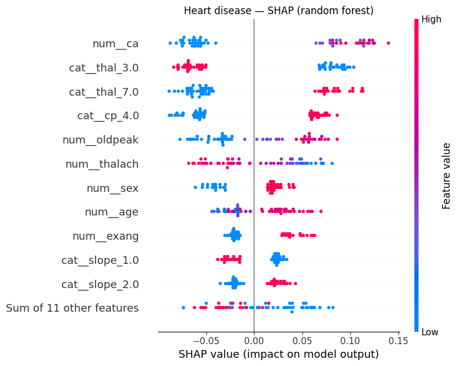

::: {.callout-note appearance="simple"}
## ใช้หน้านี้อย่างไร
หน้านี้คือ notebook `labs/lab5-challenge-heart.ipynb` ทั้งหมด พร้อมผลลัพธ์และกราฟ อ่านทวนก่อนหรือหลังคลาสได้
ช่อง TODO แสดงโค้ดตั้งต้นแบบที่เห็นในคลาส คำตอบอยู่ในกล่อง **ดูเฉลย** — ลองคิดเองก่อนเปิด
ลงมือรันจริงใน repo ที่ fork ไว้ ([เตรียมเครื่อง](../setup/github.qmd)) · ตารางเวลาและภาพรวมอยู่ที่ [แผน lab](../labs.qmd)
:::

<!-- generated by tools/build_lab_pages.py from labs/src/lab5-challenge-heart.py — edit the source, not this page -->

ใช้ทุกอย่างจาก Lab 1–3 กับโจทย์ใหม่: ทำนายว่าผู้ป่วยที่มาด้วยอาการเจ็บหน้าอก **มีหลอดเลือดหัวใจตีบ** (`target = 1`) หรือไม่
จากผลตรวจ 13 อย่าง — โจทย์นี้มี **feature แบบหมวดหมู่ (categorical)** ซึ่งต้องจัดการต่างจากตัวเลข

| คอลัมน์ | ความหมาย | ชนิด |
|---|---|---|
| `age`, `sex` | อายุ, เพศ (1 = ชาย) | ตัวเลข / 0-1 |
| `cp` | ชนิดการเจ็บหน้าอก (1 typical angina, 2 atypical, 3 non-anginal, 4 asymptomatic) | **หมวดหมู่** |
| `trestbps`, `chol` | ความดันขณะพัก (mmHg), cholesterol (mg/dL) | ตัวเลข |
| `fbs` | น้ำตาลขณะอดอาหาร > 120 mg/dL | 0-1 |
| `restecg` | ผล ECG ขณะพัก (0, 1, 2) | **หมวดหมู่** |
| `thalach`, `exang`, `oldpeak` | ชีพจรสูงสุดขณะออกกำลัง, เจ็บหน้าอกขณะออกกำลัง, ST depression | ตัวเลข / 0-1 |
| `slope` | ความชันของ ST segment (1 up, 2 flat, 3 down) | **หมวดหมู่** |
| `ca` | จำนวนหลอดเลือดหลักที่เห็นจาก fluoroscopy (0–3) | ตัวเลข (มี missing) |
| `thal` | thallium stress test (3 normal, 6 fixed defect, 7 reversible defect) | **หมวดหมู่** (มี missing) |

**ทำเองให้มากที่สุด** — TODO ในโจทย์นี้ให้ hint น้อยกว่า lab ปกติ

⚠️ *เพื่อการเรียนรู้เท่านั้น — ไม่ใช่เครื่องมือทางการแพทย์*

*Data: Janosi, Steinbrunn, Pfisterer & Detrano (1989). Heart Disease [Cleveland subset]. UCI Machine Learning Repository, doi:10.24432/C52P4X — CC BY 4.0*

```python
import warnings
warnings.filterwarnings("ignore")
import numpy as np
import pandas as pd
import matplotlib.pyplot as plt
import shap
from sklearn.model_selection import train_test_split, StratifiedKFold, cross_validate
from sklearn.pipeline import make_pipeline
from sklearn.compose import ColumnTransformer
from sklearn.impute import SimpleImputer
from sklearn.preprocessing import StandardScaler, OneHotEncoder
from sklearn.linear_model import LogisticRegression
from sklearn.ensemble import RandomForestClassifier

from mlia import show_check, RANDOM_STATE

heart = pd.read_csv("data/heart.csv")
CATEGORICAL = ["cp", "restecg", "slope", "thal"]
NUMERIC = ["age", "sex", "trestbps", "chol", "fbs", "thalach", "exang", "oldpeak", "ca"]
X, y = heart[CATEGORICAL + NUMERIC], heart["target"]
print(heart.shape, f"· มีโรค {y.mean():.0%}")
heart.head()
```

```{.text .cell-output}
(303, 14) · มีโรค 46%
```

::: {.cell-output-table}
```{=html}
<div>

<table border="1" class="dataframe">
  <thead>
    <tr style="text-align: right;">
      <th></th>
      <th>age</th>
      <th>sex</th>
      <th>cp</th>
      <th>trestbps</th>
      <th>chol</th>
      <th>fbs</th>
      <th>restecg</th>
      <th>thalach</th>
      <th>exang</th>
      <th>oldpeak</th>
      <th>slope</th>
      <th>ca</th>
      <th>thal</th>
      <th>target</th>
    </tr>
  </thead>
  <tbody>
    <tr>
      <th>0</th>
      <td>63.0</td>
      <td>1</td>
      <td>1</td>
      <td>145.0</td>
      <td>233.0</td>
      <td>1</td>
      <td>2</td>
      <td>150.0</td>
      <td>0</td>
      <td>2.3</td>
      <td>3</td>
      <td>0.0</td>
      <td>6.0</td>
      <td>0</td>
    </tr>
    <tr>
      <th>1</th>
      <td>67.0</td>
      <td>1</td>
      <td>4</td>
      <td>160.0</td>
      <td>286.0</td>
      <td>0</td>
      <td>2</td>
      <td>108.0</td>
      <td>1</td>
      <td>1.5</td>
      <td>2</td>
      <td>3.0</td>
      <td>3.0</td>
      <td>1</td>
    </tr>
    <tr>
      <th>2</th>
      <td>67.0</td>
      <td>1</td>
      <td>4</td>
      <td>120.0</td>
      <td>229.0</td>
      <td>0</td>
      <td>2</td>
      <td>129.0</td>
      <td>1</td>
      <td>2.6</td>
      <td>2</td>
      <td>2.0</td>
      <td>7.0</td>
      <td>1</td>
    </tr>
    <tr>
      <th>3</th>
      <td>37.0</td>
      <td>1</td>
      <td>3</td>
      <td>130.0</td>
      <td>250.0</td>
      <td>0</td>
      <td>0</td>
      <td>187.0</td>
      <td>0</td>
      <td>3.5</td>
      <td>3</td>
      <td>0.0</td>
      <td>3.0</td>
      <td>0</td>
    </tr>
    <tr>
      <th>4</th>
      <td>41.0</td>
      <td>0</td>
      <td>2</td>
      <td>130.0</td>
      <td>204.0</td>
      <td>0</td>
      <td>2</td>
      <td>172.0</td>
      <td>0</td>
      <td>1.4</td>
      <td>1</td>
      <td>0.0</td>
      <td>3.0</td>
      <td>0</td>
    </tr>
  </tbody>
</table>
</div>
```
:::

## C.1 แบ่ง train / test {#sc-1}

::: {.theory-link}
ทฤษฎีของหัวข้อนี้: [M1](../m1-classification/index.qmd) · [M2](../m2-models/index.qmd) · [M3](../m3-shap/index.qmd)
:::

เหมือน Lab 1: 80/20, `stratify=y`, `random_state=RANDOM_STATE`

```python
# TODO C.1: แบ่ง X, y เป็น X_train, X_test, y_train, y_test
X_train, X_test, y_train, y_test = ___
show_check(len(X_test) == 61, "แบ่งได้ train 242 / test 61", "ตรวจ test_size และ stratify")
```

::: {.callout-tip collapse="true" appearance="simple"}
## ดูเฉลย

```python
# ✔ TODO C.1: แบ่ง X, y เป็น X_train, X_test, y_train, y_test
X_train, X_test, y_train, y_test = train_test_split(X, y, test_size=0.2, stratify=y, random_state=RANDOM_STATE)
show_check(len(X_test) == 61, "แบ่งได้ train 242 / test 61", "ตรวจ test_size และ stratify")
```
:::

```{.text .cell-output}
✅ แบ่งได้ train 242 / test 61
```

## C.2 ColumnTransformer: จัดการตัวเลขกับหมวดหมู่ต่างกัน {#sc-2}

::: {.theory-link}
ทฤษฎีของหัวข้อนี้: [M1](../m1-classification/index.qmd) · [M2](../m2-models/index.qmd) · [M3](../m3-shap/index.qmd)
:::

`cp = 4` ไม่ได้ "มากกว่า" `cp = 2` เป็นสองเท่า — มันคือ **ชื่อหมวด** ถ้าใส่เป็นตัวเลขตรง ๆ logistic regression จะเข้าใจผิด
**One-hot encoding** แตกเป็นคอลัมน์ 0/1 ต่อหมวด (`cp_1`, `cp_2`, …)

`ColumnTransformer` ส่งแต่ละกลุ่มคอลัมน์เข้า pipeline ย่อยของตัวเอง:
- ตัวเลข → `SimpleImputer(strategy="median")` → `StandardScaler()`
- หมวดหมู่ → `SimpleImputer(strategy="most_frequent")` → `OneHotEncoder(handle_unknown="ignore")`

```python
# TODO C.2: เติม pipeline ย่อยของ "cat" ให้ครบ (imputer most_frequent → OneHotEncoder(handle_unknown="ignore", sparse_output=False))
preprocess = ColumnTransformer([
    ("num", make_pipeline(SimpleImputer(strategy="median"), StandardScaler()), NUMERIC),
    ("cat", ___, CATEGORICAL),
])
Xt = preprocess.fit_transform(X_train)
print(Xt.shape)
list(preprocess.get_feature_names_out())
```

::: {.callout-tip collapse="true" appearance="simple"}
## ดูเฉลย

```python
# ✔ TODO C.2: เติม pipeline ย่อยของ "cat" ให้ครบ (imputer most_frequent → OneHotEncoder(handle_unknown="ignore", sparse_output=False))
preprocess = ColumnTransformer([
    ("num", make_pipeline(SimpleImputer(strategy="median"), StandardScaler()), NUMERIC),
    ("cat", make_pipeline(SimpleImputer(strategy="most_frequent"),
                          OneHotEncoder(handle_unknown="ignore", sparse_output=False)), CATEGORICAL),
])
Xt = preprocess.fit_transform(X_train)
print(Xt.shape)
list(preprocess.get_feature_names_out())
```
:::

```{.text .cell-output}
(242, 22)
```

```{.text .cell-output}
['num__age',
 'num__sex',
 'num__trestbps',
 'num__chol',
 'num__fbs',
 'num__thalach',
 'num__exang',
 'num__oldpeak',
 'num__ca',
 'cat__cp_1.0',
 'cat__cp_2.0',
 'cat__cp_3.0',
 'cat__cp_4.0',
 'cat__restecg_0.0',
 'cat__restecg_1.0',
 'cat__restecg_2.0',
 'cat__slope_1.0',
 'cat__slope_2.0',
 'cat__slope_3.0',
 'cat__thal_3.0',
 'cat__thal_6.0',
 'cat__thal_7.0']
```

```python
show_check(Xt.shape == (242, 22), "ได้ 22 คอลัมน์หลัง one-hot (9 ตัวเลข + 13 หมวด)", "ตรวจ OneHotEncoder ในส่วน cat")
```

```{.text .cell-output}
✅ ได้ 22 คอลัมน์หลัง one-hot (9 ตัวเลข + 13 หมวด)
```

## C.3 เทียบ Logistic regression กับ Random forest ด้วย 5-fold CV {#sc-3}

::: {.theory-link}
ทฤษฎีของหัวข้อนี้: [M1](../m1-classification/index.qmd) · [M2](../m2-models/index.qmd) · [M3](../m3-shap/index.qmd)
:::

ต่อ `preprocess` เข้ากับ model แต่ละตัวด้วย `make_pipeline` แล้วใช้ `cross_validate` (scoring ROC-AUC และ recall)

```python
cv = StratifiedKFold(n_splits=5, shuffle=True, random_state=RANDOM_STATE)

# TODO C.3: สร้าง models = {"Logistic regression": pipeline, "Random forest": pipeline} แล้วเก็บผล CV ใน cv_table
models = {"Logistic regression": ___, "Random forest": ___}
cv_table = ___
cv_table
```

::: {.callout-tip collapse="true" appearance="simple"}
## ดูเฉลย

```python
cv = StratifiedKFold(n_splits=5, shuffle=True, random_state=RANDOM_STATE)

# ✔ TODO C.3: สร้าง models = {"Logistic regression": pipeline, "Random forest": pipeline} แล้วเก็บผล CV ใน cv_table
models = {
    "Logistic regression": make_pipeline(preprocess, LogisticRegression(max_iter=1000)),
    "Random forest": make_pipeline(preprocess, RandomForestClassifier(n_estimators=300, min_samples_leaf=3,
                                                                      random_state=RANDOM_STATE, n_jobs=-1)),
}
cv_table = pd.DataFrame({
    name: {s: cross_validate(m, X_train, y_train, cv=cv, scoring=s)["test_score"].mean() for s in ["roc_auc", "recall"]}
    for name, m in models.items()})
cv_table
```
:::

::: {.cell-output-table}
```{=html}
<div>

<table border="1" class="dataframe">
  <thead>
    <tr style="text-align: right;">
      <th></th>
      <th>Logistic regression</th>
      <th>Random forest</th>
    </tr>
  </thead>
  <tbody>
    <tr>
      <th>roc_auc</th>
      <td>0.906525</td>
      <td>0.899822</td>
    </tr>
    <tr>
      <th>recall</th>
      <td>0.792490</td>
      <td>0.782609</td>
    </tr>
  </tbody>
</table>
</div>
```
:::

```python
show_check(cv_table.loc["roc_auc"].min() > 0.85, "ทั้งสอง model ได้ CV ROC-AUC > 0.85", "ROC-AUC ต่ำผิดปกติ — ตรวจ pipeline")
```

```{.text .cell-output}
✅ ทั้งสอง model ได้ CV ROC-AUC > 0.85
```

## C.4 SHAP ของ Random Forest {#sc-4}

::: {.theory-link}
ทฤษฎีของหัวข้อนี้: [M1](../m1-classification/index.qmd) · [M2](../m2-models/index.qmd) · [M3](../m3-shap/index.qmd)
:::

สอง model ใกล้กันมากอีกแล้ว — ลองอธิบาย Random Forest: fit กับ train → แปลง X_test ด้วยขั้น preprocess (`rf[:-1].transform`) → `TreeExplainer(rf[-1])` → beeswarm ของคลาส 1

```python
rf = models["Random forest"].fit(X_train, y_train)
names = rf[:-1].get_feature_names_out()

# TODO C.4: คำนวณ SHAP ของ X_test (คลาส 1) เก็บใน sv แล้ววาด beeswarm
X_test_t = pd.DataFrame(___, columns=names)
sv = ___
shap.plots.beeswarm(sv, max_display=12, show=False)
plt.title("Heart disease — SHAP (random forest)"); plt.tight_layout(); plt.show()
```

::: {.callout-tip collapse="true" appearance="simple"}
## ดูเฉลย

```python
rf = models["Random forest"].fit(X_train, y_train)
names = rf[:-1].get_feature_names_out()

# ✔ TODO C.4: คำนวณ SHAP ของ X_test (คลาส 1) เก็บใน sv แล้ววาด beeswarm
X_test_t = pd.DataFrame(rf[:-1].transform(X_test), columns=names)
sv = shap.TreeExplainer(rf[-1])(X_test_t)[:, :, 1]
shap.plots.beeswarm(sv, max_display=12, show=False)
plt.title("Heart disease — SHAP (random forest)"); plt.tight_layout(); plt.show()
```
:::

{.cell-figure}

```python
show_check(sv.shape == (61, 22), "ได้ SHAP 61 คน × 22 feature", "ตรวจว่าเลือกคลาส 1 ด้วย [:, :, 1]")
```

```{.text .cell-output}
✅ ได้ SHAP 61 คน × 22 feature
```

## คำถามท้าย challenge {#sคำถามท้าย}

::: {.theory-link}
ทฤษฎีของหัวข้อนี้: [M1](../m1-classification/index.qmd) · [M2](../m2-models/index.qmd) · [M3](../m3-shap/index.qmd)
:::

1. feature ไหนสำคัญที่สุด 3 อันดับ? สมเหตุสมผลทางคลินิกไหม (ลองค้น "thallium stress test", "asymptomatic chest pain")
2. `cat__cp_4.0` (asymptomatic) ดันความเสี่ยง **ขึ้น** — แปลกไหมที่ "ไม่มีอาการเจ็บแบบ angina" กลับเสี่ยงกว่า? (hint: ใครถูกส่งมาตรวจ)
3. ถ้าจะ deploy model นี้เป็น app แบบ Lab 4 ต้องแก้ไฟล์ไหนบ้าง? (`train.py`, `model_utils.py`, `app.py` — input แบบหมวดหมู่ควรเป็น `st.selectbox`)
4. ข้อมูลมาจากโรงพยาบาลเดียวในสหรัฐฯ ปี 1988 — ก่อนใช้กับผู้ป่วยไทย ต้องตรวจสอบอะไรเพิ่ม?
